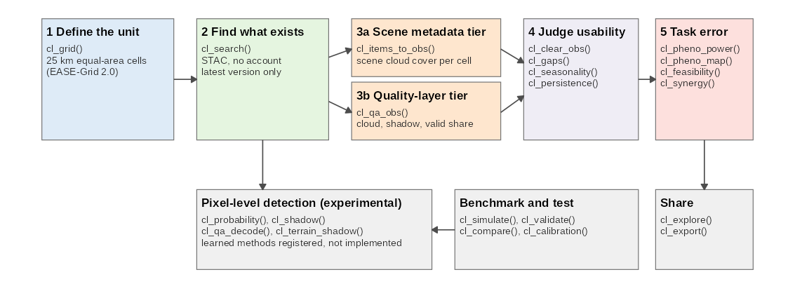
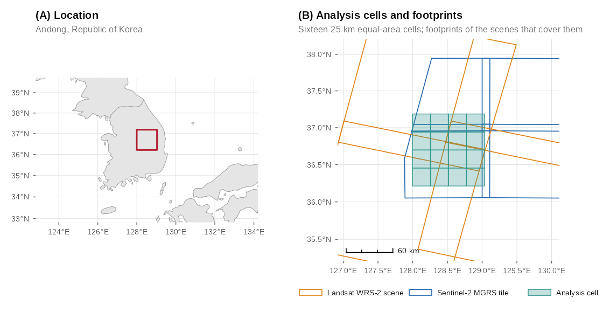
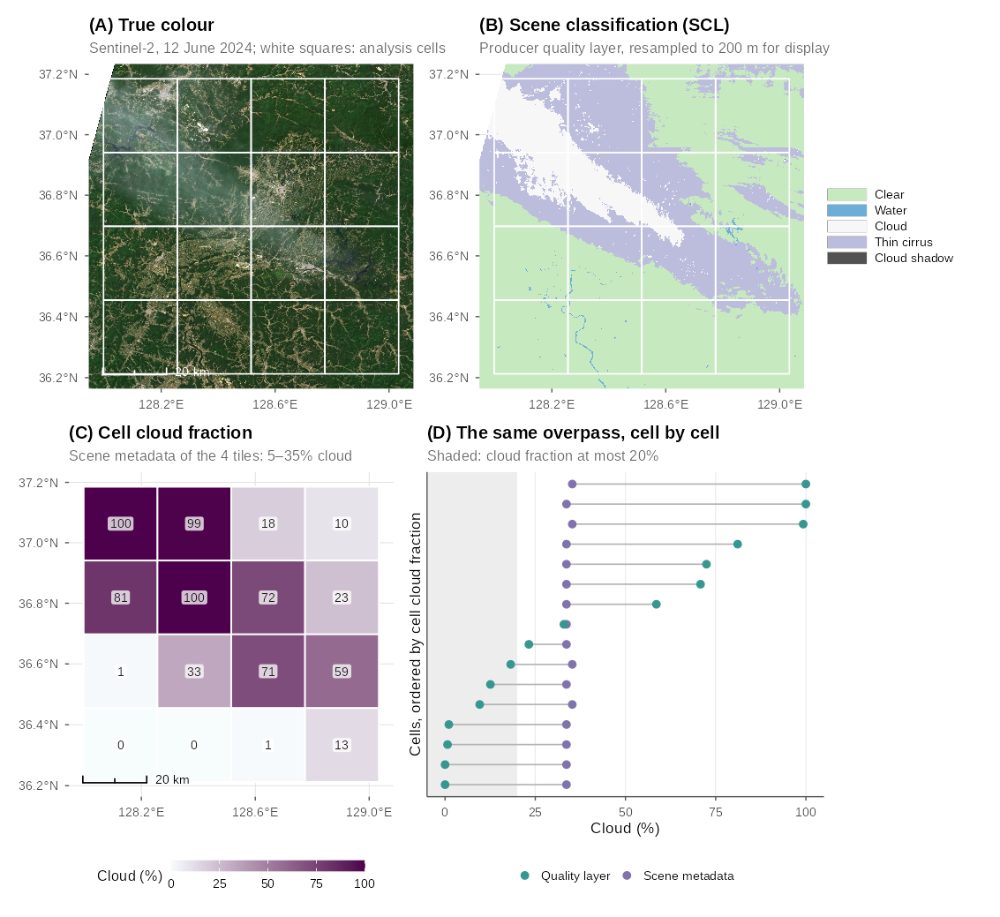
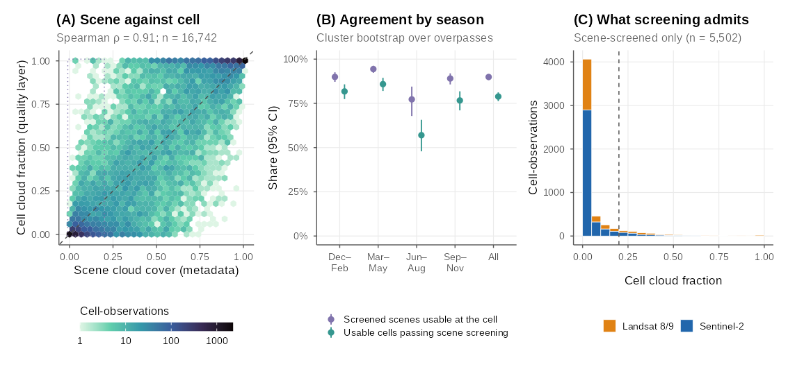
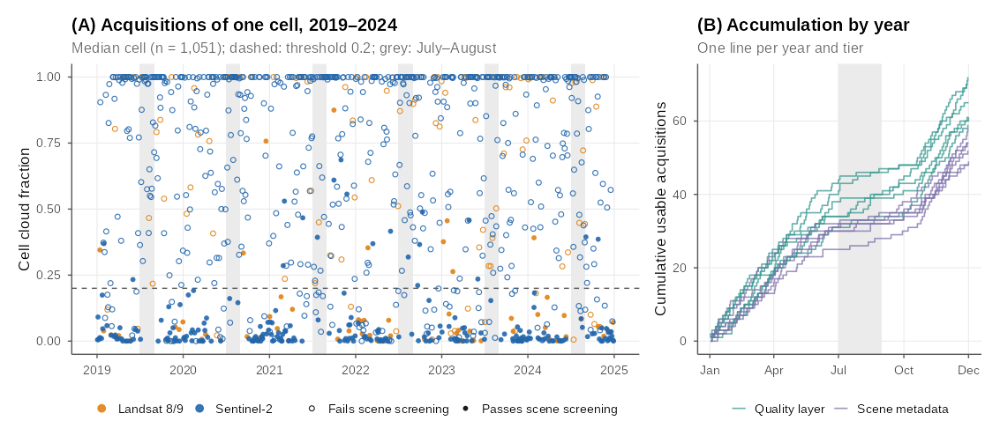
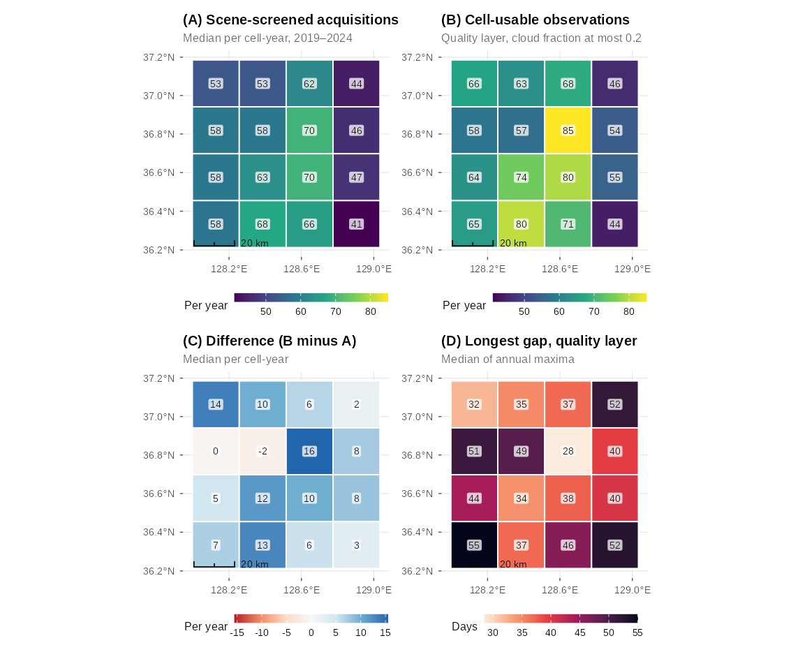
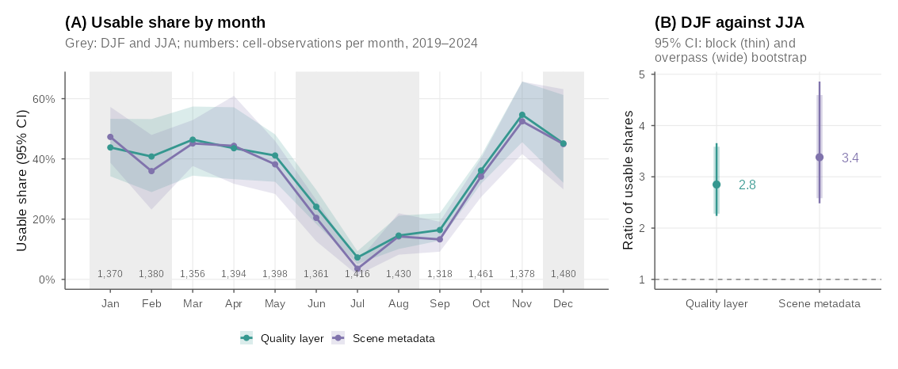
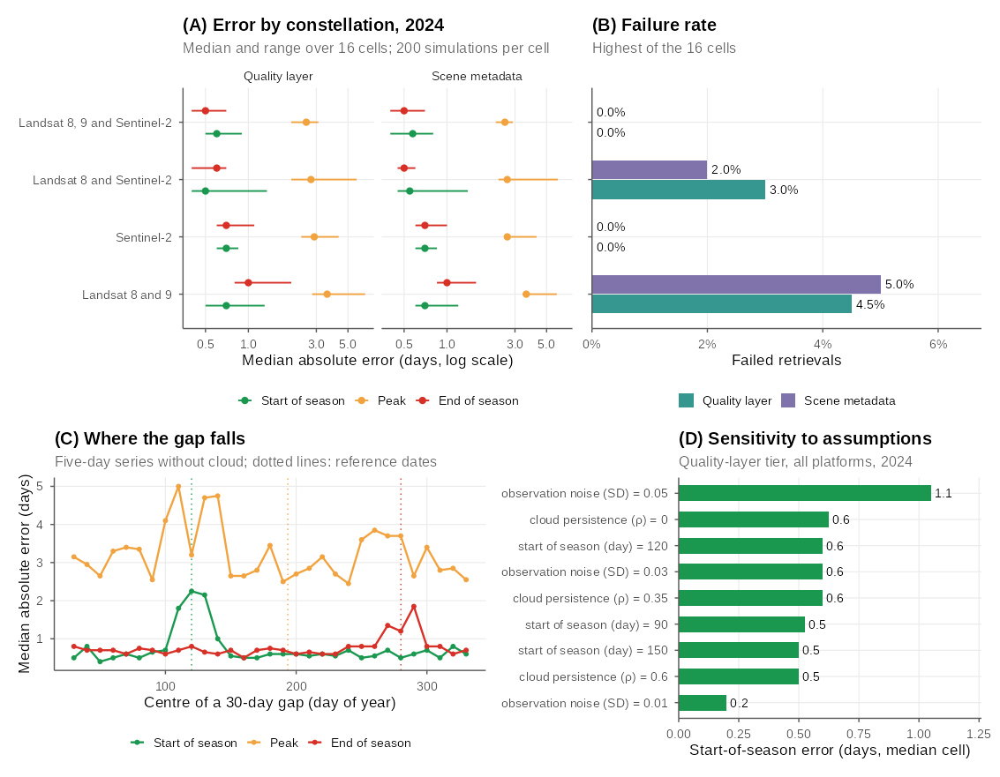

# cloudscape

[](https://github.com/ehsanrahimi666/cloudscape/actions/workflows/R-CMD-check.yaml)
[](https://ehsanrahimi666.github.io/cloudscape/)


**Clear-observation availability and cloud analysis for optical satellite image time series.**

Cloud masks tell you which pixels are cloudy. Planning a time-series study also
needs three other answers: how many usable observations remain at the study
site, when in the year they occur, and how the gaps affect the quantity you want
to estimate. `cloudscape` links these steps in one R workflow:

- it queries SpatioTemporal Asset Catalogs (no account needed) and keeps the latest processing version of every acquisition;
- it aggregates acquisitions onto an **equal-area grid** (EASE-Grid 2.0), so counts refer to the same area for every sensor and latitude;
- it records the **evidence tier** of every count: usability inferred from scene-level cloud cover, or measured within each grid cell from the producer quality layers (Landsat `QA_PIXEL`, Sentinel-2 `SCL`);
- it summarises usable counts, gaps, seasonality and cloud persistence, with every statistic carrying its unit, sample size and denominator;
- it propagates an acquisition record into the **simulated error of phenological dates** (start, peak and end of season) under stated assumptions.

<p align="center">
  
</p>

## Installation

```r
# install.packages("remotes")
remotes::install_github("ehsanrahimi666/cloudscape")
```

The statistical core depends only on base R. `terra`, `sf` and `httr2` are
suggested and loaded only when raster or network functionality is used, so the
package installs and runs its test suite without a GDAL toolchain.

## How it works: a worked example at Andong, Republic of Korea

The figures below come from the analysis in [`analysis/`](analysis), which
reproduces every number of the accompanying article from archived inputs
(Sentinel-2 and Landsat 8/9, 2019–2024, sixteen 25 km cells).

### 1. Define an equal-area study area and find what exists

```r
library(cloudscape)
grid  <- cl_grid(res = 25000)                    # EASE-Grid 2.0, 25 km cells
site  <- cl_grid_cells(grid, cl_grid_lookup(grid, 128.73, 36.57))
cells <- as.vector(outer((site$row + -3:0) * grid$ncol, site$col + -2:1, "+"))
xy    <- cl_grid_cells(grid, cells)
ll    <- cl_unproject(range(xy$x) + c(-1, 1) * grid$res / 2,
                      range(xy$y) + c(-1, 1) * grid$res / 2)
aoi   <- c(ll[1, "lon"], ll[1, "lat"], ll[2, "lon"], ll[2, "lat"])

items <- cl_search(aoi, "sentinel-2-msi", "2019-01-01", "2024-12-31", limit = Inf)
```

Landsat scenes and Sentinel-2 tiles cover the same ground with footprints of
different size and placement; the grid cells do not change between sensors.

<p align="center"></p>

### 2. Scene metadata or quality layers?

```r
meta <- cl_items_to_obs(items, grid)      # scene-level cloud cover, every covered cell
qa   <- cl_qa_obs(items, grid, cells)     # cloud fraction measured within each cell
```

A scene's cloud cover is an average over its footprint. On the overpass below,
the four Sentinel-2 tiles report heavy cloud while the quality layer shows that
some cells were nearly clear, and others completely overcast.

<p align="center"></p>

Across all acquisitions, the two evidence tiers can be compared directly, with
confidence intervals that resample whole overpasses:

<p align="center"></p>

### 3. How many usable observations, where and when?

```r
cl_clear_obs(qa, by = "year")       # usable observations per cell and year
cl_gaps(qa, critical = 21)          # longest stretch without a usable observation
cl_seasonality(qa, harmonics = 2)   # seasonal cycle and best acquisition window
cl_persistence(qa)                  # decorrelation time, with and without the seasonal cycle
```

<p align="center"></p>
<p align="center"></p>
<p align="center"></p>

### 4. What does the record mean for phenology?

```r
pheno <- cl_pheno_map(qa, year = 2024, n_sim = 200, threshold = 0.2,
                      noise = 0.03, persistence = 0.35, seed = 20241)
```

Each cell's actual acquisition dates and cloud fractions are used to sample a
known double-logistic trajectory, which is refitted 200 times. The result is a
simulated error, in days, of the start, peak and end of season, and the share
of failed retrievals. These values depend on the assumed curve, noise and cloud
persistence; they describe the information in the acquisition record, not the
accuracy of a retrieval from real data.

<p align="center"></p>

## Quick start without a network connection

```r
library(cloudscape)
d <- seq(as.Date("2024-01-01"), as.Date("2024-12-31"), by = "5 days")
for (cf in c(0.3, 0.6, 0.85)) {
  r <- cl_pheno_power(d, cloud_fraction = cf, n_sim = 200, seed = 1)
  print(round(r$summary[, c("n_usable_median", "sos_mae", "peak_mae",
                            "eos_mae", "failure_rate")], 2))
}
#>   n_usable_median sos_mae peak_mae eos_mae failure_rate
#> 1            52.5     0.9      3.6     0.9            0
#>   n_usable_median sos_mae peak_mae eos_mae failure_rate
#> 1              30     1.4      6.2     1.4         0.03
#>   n_usable_median sos_mae peak_mae eos_mae failure_rate
#> 1              12     3.1    12.45     4.6         0.39
```

Statistics carry their units and are checked on construction:

```r
cl_stats(1:2, "cloud_fraction", c(0.3, 1.4))
#> Error: Metric 'cloud_fraction' has value 1.4 outside its permitted range [0, 1] (row 2).
```

## Sensors and detection methods

Drivers are supplied for Landsat 4–9, Sentinel-2, MODIS and a generic
multispectral camera (PlanetScope, WorldView, SPOT, RapidEye, UAV). Adding a
sensor means writing one driver:

```r
cl_sensor_register(cl_sensor_driver(
  id = "my-sensor", name = "My camera",
  bands = c(blue = "B1", green = "B2", red = "B3", nir = "B4"),
  revisit = 5))
cl_methods(sensor = "my-sensor")   # which algorithms are applicable
```

| Method | Type | Status in 0.2.0 |
|---|---|---|
| `qa` | Producer mask | Implemented: decodes CFMask `QA_PIXEL` and Sen2Cor `SCL` |
| `threshold` | Physical | Implemented: brightness and whiteness baseline |
| `fmask` | Physical | Implemented: decision cascade following Zhu and Woodcock (2012) |
| `s2cloudless`, `randomforest`, `xgboost`, `unet` | Learned | Registered, not implemented; no model weights are distributed |

The pixel-level detectors, the shadow search and the scene simulator are
verified against analytical identities and synthetic scenes, but they have not
been validated against labelled imagery; treat them as experimental. A trained
model can be supplied through `cl_method_register()`.

## Reproducing the article's analysis

From the repository root, run the scripts in `analysis/` in numerical order
(`01_query.R` to `07_numbers.R`). `analysis/config.R` holds every setting.
The catalogue records, quality-layer extracts and image subsets used in the
article are archived in `analysis/data/`, so the scripts from `03` onwards run
without a network connection, except `05b_scene_example.R`, which downloads the
two image subsets again.

## Citation

Rahimi, E. and Jung, C. cloudscape: clear-observation availability and cloud
analysis for optical satellite image time series. R package version 0.2.0.
https://github.com/ehsanrahimi666/cloudscape
